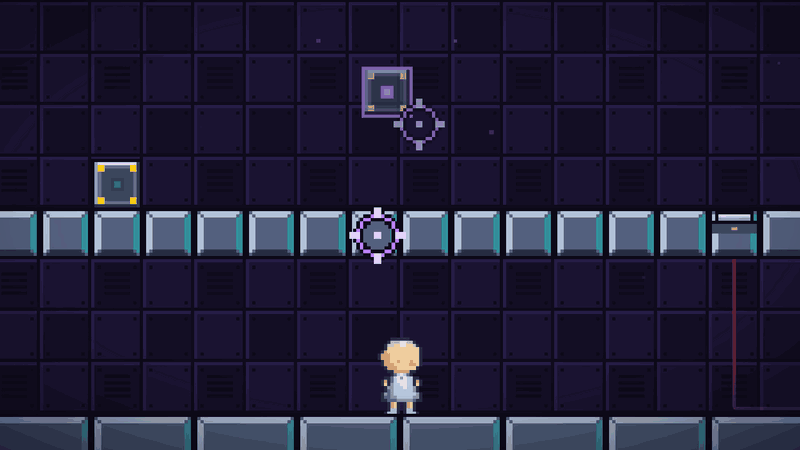
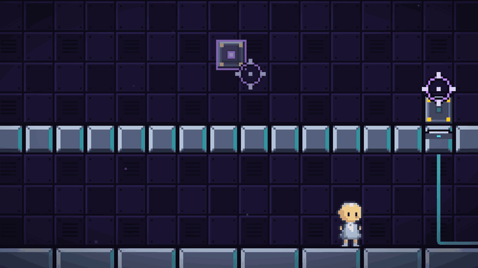
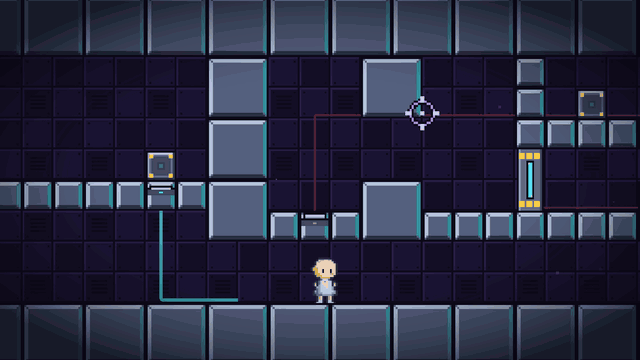
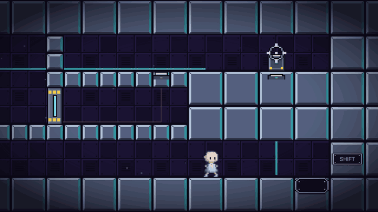
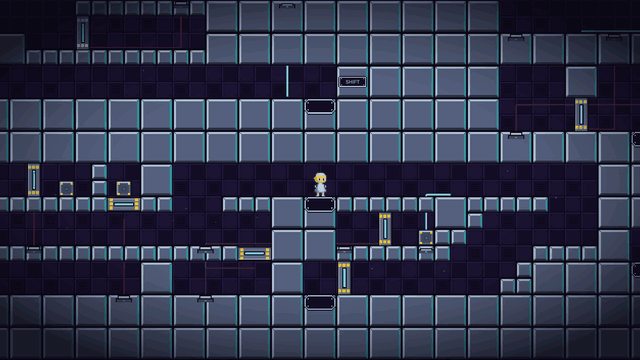

<p align="center">
  
</p>

# PSI-KID

**A 2D telekinesis puzzle-platformer: a psychic girl escapes a lab, room by room, by moving crates with her mind.**

<p>
  <a href="https://nikolasraposo.itch.io/psi-kid"><b>▶ Play in browser</b></a> ·
  <a href="https://youtu.be/AGGcf6Jo-eU">🎬 Trailer</a> ·
  <a href="https://nikolasraposo-portfolio.vercel.app/projetos/psi-kid/">🌐 Case study</a>
</p>

`Unity 6000.3.9f1` · `C#` · `WebGL` · `License: MIT (code)`

| | |
|---|---|
| **My role** | Solo developer (code, level design, art direction) |
| **Origin** | FIAP (Game Development), 2024 · reworked in 2026 |
| **Status** | Playable prototype, one full level (7 rooms) |
| **Platforms** | WebGL (itch.io), Windows |

## What I built

- **Telekinesis controller**: raycast selection, gravity off while held, `Rigidbody2D.MovePosition` dragging that keeps the throw velocity on release, plus feedback that reads on screen (psychic beam, aura, particles, hum).
- **Pressure plates as logic gates**: each plate counts its occupants, can require a **minimum total mass**, and can **require other plates (AND)**. Wires drawn behind the walls show which plate drives which door and light up when the condition is met.
- **Lab doors** that retract like shutters, and **event-driven elevators** (the player raises a request, the pad it stands on teleports it a floor).
- **One input layer** (`GameInput`) on the Input System for keyboard, mouse and gamepad, with a replaceable source used by a **scripted demo director** that plays the level and records 1080p frames for trailers.
- **Level design**: 7 rooms that introduce one rule at a time, ending in a multi-floor challenge room.

## Gallery

| Pressure plates hold doors open | Chained puzzle (real solve, 1.5x) |
|---|---|
|  |  |
| **Event-driven elevators** | **Level design: 7 rooms** |
|  |  |

## Context, goal, challenges, learnings

**Context.** A solo project for FIAP's Game Development course, reviewed at every stage. In 2026 I reworked it as a portfolio piece: new art, feedback, sound and tooling.

**Goal.** A short vertical slice that proves the telekinesis + plates loop is readable and fun.

**Challenges.**
- **Every crate reacted to every click** (each crate carried its own controller) → each controller now only answers clicks on its own crate → one beam, one sound, no duplicated drags.
- **Doors vanished instantly** (`SetActive(false)`), so viewers missed what a plate did → shutter animation + wires + plate LEDs → cause and effect are visible in a GIF.
- **Trailer capture by hand was slow and inconsistent** → a text-scripted demo director drives the same input layer the player uses and records frames at a fixed rate → repeatable takes, with sound-effect timings logged per frame for the edit.

**What I learned.** Gameplay feedback matters as much as the rule itself; and building input as a replaceable source pays off in testing and capture.

## Tech stack

- **Engine:** Unity 6000.3.9f1 (Built-in 2D)
- **Packages:** Input System, Cinemachine, 2D Tilemap, TextMeshPro
- **Tools:** Git, Python (Pillow) for generated pixel art and media, ffmpeg

## How to run

**Fastest:** play the build on [itch.io](https://nikolasraposo.itch.io/psi-kid) (browser, no install).

**From source:**
1. Clone the repo.
2. Open it with Unity 6000.3.x.
3. Open `Assets/Scenes/MainMenu/Main Menu.unity` and press Play.

### Controls

| Action | Keyboard / mouse | Gamepad |
| --- | --- | --- |
| Move | A / D or ← / → | Left stick |
| Jump | Space, W or ↑ | South button |
| Telekinesis (grab and drag a crate) | Hold left mouse button | — |
| Use elevator | Shift or E | West button |
| Pause | Esc | — |

## Project structure

```
Assets/
  Scripts/
    Gameplay/      ObjectController (telekinesis), PressurePlate, Door, PlateWire, BoxImpactSound, Player/
    Input System/  GameInput (single input layer), PlayerInputSystem
    Systems/       Sfx, LabAmbience, PsiCursor, GameManager, PauseManager, CameraController
    Utilities/     ElevatorController, ChangeCam, EndGame, MainMenuController
    Dev/           DemoDirector, ScriptedInput, FrameRecorder (capture tools)
  Resources/Art    generated pixel art (Tools/art/gerar_arte.py)
  Resources/Sfx    sound effects (CC0)
Tools/art/         Python generators for the pixel art and the character sheets
```

## Credits

Solo project by Nikolas Raposo.

- Environment tiles: [Free Pixel Art Tiles by TotusLotus](https://totuslotus.itch.io/free-pixel-art-tiles), recolored.
- Sound effects: [Kenney](https://kenney.nl) Interface Sounds and Sci-Fi Sounds (CC0).
- Music: "Magic Puzzle In-Game 1" and "Cozy Puzzle Title" by [MintoDog](https://opengameart.org/users/mintodog) (CC0).
- Part of the code and art was produced with AI assistance and reviewed by me.

## License

Code: MIT. See [LICENSE](LICENSE). Third-party assets keep their own licenses (above).
